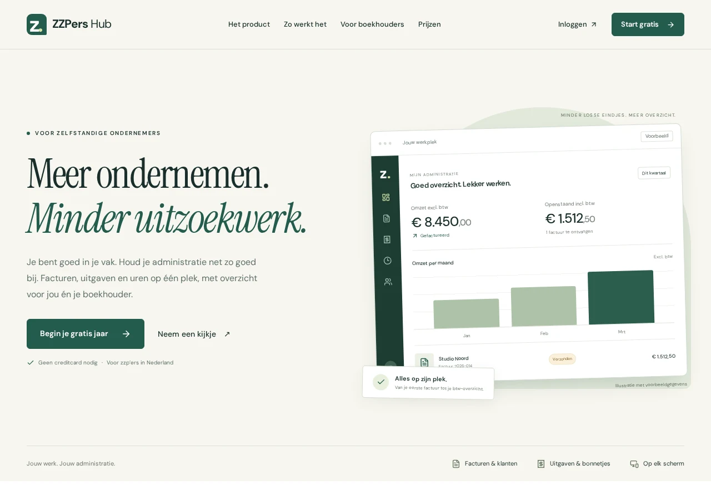

# Public homepage redesign

## Direction

An ivory, ink and forest-green identity with Instrument Serif headings and DM
Sans interface text. Both font families are self-hosted with their SIL Open
Font License files. Page colors and selectors are scoped to `.landing-page`;
application and authentication styling are independent.

Replace the long image-led feature sequence with a clear introduction,
interactive invoice/expense/hour examples, three setup steps, accountant
collaboration, the free-year offer, native FAQ disclosures and a compact footer.
All financial examples are labeled as fictional. There are no fabricated
customer counts, testimonials, subscription confirmations or social links.

The old route JS asset was about 51.11 kB (12.12 kB gzip); the new route is
22.12 kB (6.20 kB gzip), excluding shared chunks. The new route CSS is 25.80 kB
(5.95 kB gzip) and the three self-hosted font files total 80,092 bytes. No old
marketing PNG is requested by the redesigned page. This is an asset comparison,
not a measured page-load score. Existing shared JS chunk warnings remain.

The main product/pricing/authentication routes retain their behavior. The
homepage links to the prices page for current paid tariffs rather than repeating
the conflicting legacy paid amounts. The no-JS fallback, metadata and FAQ schema
are aligned with the rewritten Dutch copy.

## Validation

- Production build and TypeScript checks, ESLint and 115 frontend tests pass.
- 22 Chromium browser checks cover the existing CSS regressions and the new
  homepage. Desktop/mobile projects exercise tabs by mouse and keyboard, FAQ
  disclosures, menu dismissal/focus, cookie persistence, fragment destinations,
  the public root without a session/API, theme isolation and layouts from 320px
  through 1440px.
- Visually inspected desktop and mobile captures. Mobile Chromium emulation
  does not replace Safari or physical-device testing.

## Captures

Desktop:

Mobile:

